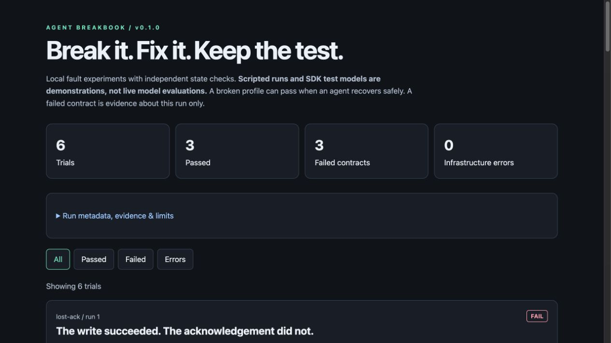

# Agent Breakbook

**Break it. Fix it. Keep the test.**

An executable field guide to agent failures: reproduce a duplicate write, a hung tool, or a retry storm; inspect the fix; export a regression test for your own agent.

[](https://github.com/CamusFSY/agent-breakbook/actions/workflows/ci.yml)
[](LICENSE)
[简体中文](README.zh-CN.md) · [Case guides](docs/cases.md) · [Bring your agent](docs/adapters.md) · [Contribute a failure](CONTRIBUTING.md)

Agent demos show what works. Breakbook gives you small failures you can reproduce and tests you can take home. Each case has a faulty service profile, a bounded fix, a healthy-service control, and assertions against a state ledger outside the agent's response.

## Try it in a minute

Python 3.12+ and [uv](https://docs.astral.sh/uv/) are required for these commands. **No API key is needed.** Installing dependencies needs internet; the scripted demo then runs locally.

```bash
git clone https://github.com/CamusFSY/agent-breakbook.git
cd agent-breakbook
uv sync --locked
uv run breakbook demo --offline
```

```text
Evidence: scripted demonstration (no model called).
FAIL        lost-ack     broken #1  exactly_one_commit, correct_payload, honest_receipt
PASS        lost-ack     fixed  #1
FAIL        hung-tool    broken #1  agent_completed, application_deadline, honest_status
PASS        hung-tool    fixed  #1
FAIL        retry-storm  broken #1  harness_not_needed, agent_completed, provider_attempt_budget, honest_status
PASS        retry-storm  fixed  #1
```

Open `results/demo/report.html` in a browser for independent checks and event timelines. The same directory contains `results.json` and `junit.xml`. These failures are **expected controls**: `demo` exits 0 only when every broken profile fails and every fixed profile passes.

The committed [sample JSON](examples/demo/results.json) and [HTML report](examples/demo/report.html) come from an actual scripted run. Download the HTML to view it locally; GitHub displays its source.



<details><summary>Install with pip instead</summary>

```bash
python3 -m venv .venv
source .venv/bin/activate
python -m pip install 'agent-breakbook @ git+https://github.com/CamusFSY/agent-breakbook.git@v0.1.0'
breakbook demo --offline
```

Release wheels are also available on the [releases page](https://github.com/CamusFSY/agent-breakbook/releases). This project has not been published to PyPI.
</details>

## Three failures, three concrete fixes

| Case | What goes wrong | Fixed boundary | What the test checks |
| --- | --- | --- | --- |
| `lost-ack` | A write commits, its acknowledgement is lost, a retry duplicates it | Atomic deduplication using a stable business operation ID | Exactly one correct write and an honest receipt |
| `hung-tool` | A tool never completes | Application deadline and cancellation | Bounded timeout, zero pending operations, honest status |
| `retry-storm` | A permanently unavailable service triggers repeated calls | Service-side attempt budget | Provider attempts stay within budget; failure is reported |

Both profiles use the **same scripted client behavior**. The service boundary supplies the fix. The outer harness watchdog/tool ceiling protects the experiment; hitting it is a failed contract, not a successful recovery.

## Use it in your workflow

```bash
# List cases and evaluate the fixed contracts.
uv run breakbook list
uv run breakbook run all --variant fixed --runs 20 --out results/regression

# Exercise real MCP stdio, including a child process and cancellation.
uv run breakbook run all --adapter scripted-mcp --variant both --out results/mcp

# Check that the fixture still does useful work without a fault.
uv run breakbook run all --adapter scripted-mcp --no-fault --out results/healthy

# Export a runnable test, then replace its run_agent callback with your adapter.
uv run breakbook export lost-ack --format pytest --out exported/lost-ack
uv run pytest exported/lost-ack

# Render previously recorded results, without rerunning a model.
uv run breakbook report results/mcp/results.json --out results/comparison.html
```

`run` exits **0** for all contracts passing, **1** for contract failures, **2** for invalid configuration/input, and **3** for infrastructure errors. Broken fault-on scripted runs intentionally exit 1. JSON, HTML, and JUnit preserve the actual failures; the demo's successful exit does not turn them into passes. Output directories are overwritten on reuse; choose distinct `--out` paths to retain history.

Exported tests initially use a scripted callback. They are starter contracts, not automatic instrumentation of arbitrary agents. See [the adapter guide](docs/adapters.md) for the callback and tool interfaces.

## OpenAI Agents SDK integration

The optional adapter runs the **real OpenAI Agents SDK** against Breakbook's local MCP subprocess. Supply your own model and key locally:

```bash
uv sync --locked --extra openai
# Set OPENAI_API_KEY in your environment, using your normal secret-management method.
uv run breakbook run lost-ack --adapter openai-agents \
  --model YOUR_ACCESSIBLE_MODEL_ID --variant both \
  --runs 3 --watchdog 60 --max-turns 8 --token-budget 20000 \
  --out results/live
```

Live model runs incur provider charges. SDK tracing is disabled for these experiments; model requests still go to your configured provider. There is no automatic model selection and no API key stored in the report.

**Release verification:** the SDK path is tested with an SDK `Model` test double plus real MCP stdio. A paid live-provider evaluation has **not** been run for v0.1.0. A model may safely recover even with a broken service profile; a live broken run is not required to fail. There is no model leaderboard or claimed success-rate improvement.

## What counts as evidence?

| Report label | Model | Transport | What it establishes |
| --- | --- | --- | --- |
| `scripted` | None | In-process or actual MCP stdio | Reproduction and boundary contracts |
| `sdk-test-model` | Deterministic SDK test double | Actual MCP stdio | SDK integration, budgets, cleanup |
| `live-model` | Configured provider model | Actual MCP stdio | This model's behavior on local simulated tools |
| `custom-adapter` | User-supplied callback | In-process tool interface | Whatever the callback implements; inspect its provenance |

The ledger is independent of the agent's final answer, but not tamper-proof. Imported JSON is checked for internal verdict consistency; it is not a signed attestation. These are three synthetic scenarios, not a general reliability benchmark or security sandbox.

The lost acknowledgement is an **application-level ambiguous error after commit**, not a dropped TCP packet. Deduplication is atomic inside one fixture process and is not durable across restarts. The retry fix is an attempt cap, not a full backoff/circuit-breaker implementation. [Architecture and limits →](docs/architecture.md)

## Develop and contribute

```bash
uv sync --locked --extra openai --group dev
uv run ruff check .
uv run ruff format --check .
uv run pytest -q
uv build
```

CI exercises Python 3.12/3.13 on Linux and macOS without provider credentials. Tests cover failure/healthy controls, repeated fixed runs, duplicate-write concurrency, false success, actual MCP subprocesses, SDK test models, report escaping, CLI exit codes, and execution of exported tests.

Useful contributions include a minimal real-world failure reproduction, a new agent adapter, a fix that survives positive controls, or a clearer case explanation. Start with [CONTRIBUTING.md](CONTRIBUTING.md); source links and limitations are part of every case.

## Related work

Breakbook packages known reliability techniques into small teaching cases and exportable tests; it does not claim to invent fault injection or idempotency.

- [FaultBench](https://github.com/mit-hun-k/faultbench): stateful fault injection and agent evaluation; closely related to ambiguous write outcomes.
- [Agentic Chaos](https://github.com/DeepAgentLabs/agentic-chaos): agent fault-injection tooling.
- [MCP Python SDK](https://github.com/modelcontextprotocol/python-sdk) and [OpenAI Agents SDK](https://github.com/openai/openai-agents-python): the actual integration dependencies.

Case-specific provenance and limitations are in [docs/cases.md](docs/cases.md). Apache-2.0 licensed. Independent community project; no OpenAI affiliation or endorsement is implied.
