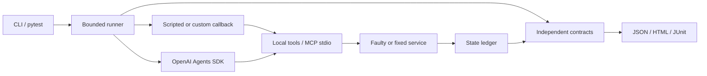

# Architecture and limits

Each trial owns a fresh world. In-process callbacks receive only an async tool-call function. MCP adapters launch `python -m breakbook.mcp_server` with the same interpreter as the client; no separate server installation is needed. The child atomically replaces a temporary JSON ledger as events occur. The runner reads the final state after the MCP context closes.

Application errors are structured tool data (`ok: false`, `error: ...`). MCP protocol errors, child failures, and SDK/provider exceptions become `infra_error`; they are not credited as an agent failure recovery. Exception class names are persisted, not potentially sensitive exception messages. Some dependency diagnostics may still appear on the local terminal.

The verifier is separate from the client policy. It validates useful work, exercised faults, cleanup, bounded attempts, real committed state, and honest outputs. It does not trust success prose. Custom callbacks and local files are not hostile-code sandboxes; a trusted contributor could falsify a fixture or ledger. Reports do not offer cryptographic provenance.

## Budgets

| Setting | Scripted default | MCP scripted CLI | Live SDK CLI | Meaning |
| --- | --- | --- | --- | --- |
| `tool_timeout` | 0.05 s | 0.1 s | 1 s | Fixed hung-tool application deadline |
| `watchdog` | 0.25 s | 2 s | 60 s | Agent execution, excluding MCP connection setup/teardown |
| `retry_attempts` | 3 | 3 | 3 | Maximum fixed-service inventory attempts |
| `max_tool_calls` | 8 | 8 | 8 | Fixture execution ceiling; further requests return a stop error |
| `max_turns` | N/A | N/A | 8 | SDK turns |
| `max_output_tokens` | N/A | N/A | 512 | Per-model-request output-token setting |
| `token_budget` | N/A | N/A | 20,000 | Cumulative reported tokens, checked by SDK hooks |

The Python API defaults to `Limits()` for all adapters; pass a longer watchdog for live models. The CLI sets adapter-appropriate defaults. Ranges are validated and the harness ceiling must exceed the retry budget.

The token budget is **soft**: a completed model request can overshoot it, and input tokens cannot be capped by an output-token setting. Provider retries and in-flight requests can incur costs before cancellation. It is not a hard monetary cap. A returned tool-budget error also cannot force an arbitrary agent to stop thinking; the SDK turn limit and watchdog bound the rest of a run. Custom callbacks must cooperate with asyncio cancellation.

`max_retry_attempts=0` disables the MCP wrapper's own retry loop. This does not claim to change all retries inside a model provider SDK. `RunConfig(tracing_disabled=True)` disables Agents SDK trace export for these runs, while the selected model provider receives its normal requests. Only local synthetic tool data is needed by the built-in cases.

## Formats and portability

JSON schema version 1 records versions, limits, evidence labels, verdicts, contract checks, usage (when available), and state events. `breakbook report` rejects unknown schema versions or checks/verdicts inconsistent with the recorded state. It cannot determine whether a self-reported model label is authentic.

HTML has no CDN dependencies, remote fonts, analytics, or execution of tool content. Dynamic values are escaped and result filters work offline. JUnit distinguishes contract failures from infrastructure errors. Broken controls remain failures in JUnit even when a successful `demo` command expected them.

The first release pins MCP 1.30.0 and OpenAI Agents SDK 0.23.1. `uv.lock` fixes the tested development environment. Python 3.12/3.13 on Linux/macOS are the CI targets. Other versions/platforms may work but are not claimed as verified.

## Deliberate first-release scope

Three synthetic cases, sequential trials, one optional live SDK integration, and a replaceable Python callback. No hosted dashboard, credentials service, production traffic proxy, durable distributed ledger, model ranking, or claimed star target. New cases should add substantive failure coverage before adding framework breadth.
